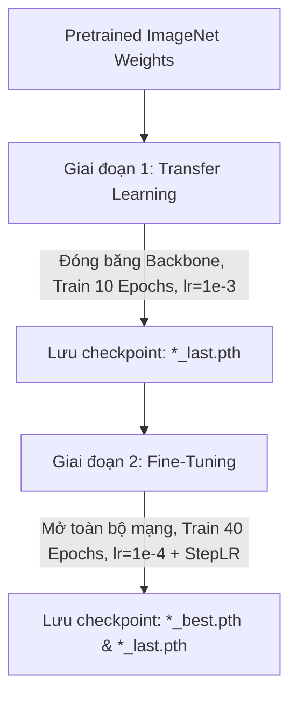

# Dự Án Phân Loại Giới Tính Qua Ảnh Khuôn Mặt (Gender Classification)

Dự án phát triển bài toán thị giác máy tính (Computer Vision) nhằm nhận diện và phân loại giới tính khuôn mặt thành hai nhóm: **Nam (Male)** và **Nữ (Female)**. Quy trình được xây dựng hoàn chỉnh từ tiền xử lý, tăng cường dữ liệu, huấn luyện chuyển giao (Transfer Learning), tinh chỉnh (Fine-tuning), phân tích lỗi (Error Analysis), đến kết hợp đa mô hình (Ensemble) cùng kỹ thuật Test-Time Augmentation (TTA).


##  Tổng Quan Kiến Trúc & Công Nghệ

* **Framework học sâu:** PyTorch (`torch`, `torchvision`)
* **Thư viện tăng cường dữ liệu:** `albumentations`
* **Xử lý ảnh & trực quan hóa:** `opencv-python`, `matplotlib`, `numpy`
* **Tiến trình:** `tqdm`
* **Mô hình Pretrained:**
  * **ResNet-18** (ImageNet-1K V1)
  * **EfficientNet-V2-S** (ImageNet-1K V1)

##  Cấu Trúc Thư Mục Dữ Liệu

Tập dữ liệu được tổ chức theo cấu trúc tiêu chuẩn của `ImageFolder`:

```text
Dataset/
├── Train/
│   ├── Female/
│   │   ├── img_001.jpg
│   │   └── ...
│   └── Male/
│       ├── img_002.jpg
│       └── ...
├── Val/
│   ├── Female/
│   │   └── ...
│   └── Male/
│       └── ...
└── Test/
    ├── test_001.jpg
    ├── test_002.jpg
    └── ...
```

---

##  Cài Đặt Môi Trường

Khuyến nghị sử dụng Python 3.9+ và môi trường có GPU hỗ trợ CUDA. Cài đặt các gói phụ thuộc:

```bash
pip install torch torchvision --index-url https://download.pytorch.org/whl/cu118
pip install albumentations opencv-python matplotlib tqdm torchinfo


##  Quy Trình Xử Lý Dữ Liệu & Augmentation

Thư viện **Albumentations** được áp dụng để tăng cường tính đa dạng của dữ liệu huấn luyện, giúp mô hình thích nghi tốt với các điều kiện khuôn mặt trong thực tế:

### 1. Tập Huấn luyện (`train_transform`)
* **Kích thước & Cắt cúp:** `Resize(256, 256)` kết hợp `RandomResizedCrop(224, 224, scale=(0.4, 1.0))`.
* **Biến đổi hình học:** 
  * `HorizontalFlip(p=0.5)` (lật ngang).
  * `Affine(scale=(0.8, 1.2), rotate=(-40, 40), translate_percent=(-0.1, 0.1), shear=(-10, 10))` (xoay, kéo dãn, méo góc).
* **Mô phỏng che khuất (Occlusion):** `CoarseDropout(num_holes_range=(1, 6), hole_height_range=(0.1, 0.2), hole_width_range=(0.1, 0.2))` (che các vùng ngẫu nhiên trên mặt mô phỏng đeo khẩu trang, kính, tóc che).
* **Màu sắc & Nhiễu:**
  * `ToGray` và `ChannelDropout` để tránh phụ thuộc quá mức vào màu da/son môi.
  * `ColorJitter` (đổi độ sáng, tương phản, độ bão hòa, sắc độ).
  * `Blur`, `Sharpen`, `GaussNoise`.
* **Chuẩn hóa:** `Normalize(mean=[0.485, 0.456, 0.406], std=[0.229, 0.224, 0.225])` và chuyển đổi sang PyTorch Tensor (`ToTensorV2`).

### 2. Tập Kiểm định (`val_test_transform`)
* `Resize(256, 256)` $\rightarrow$ `CenterCrop(224, 224)` $\rightarrow$ `Normalize` $\rightarrow$ `ToTensorV2`.

---

##  Kiến Trúc Mô Hình & Tinh Chỉnh (Customization)

Cả hai mô hình đều được khởi tạo với trọng số huấn luyện sẵn trên ImageNet và chỉnh sửa phần đầu phân loại (Classification Head) để phù hợp cho bài toán nhị phân (2 classes):

### ResNet-18
* **Backbone:** Trích xuất đặc trưng với chiều ra `in_features = 512`.
* **Tầng phân loại thay thế (`fc`):**
  ```python
  model.fc = nn.Sequential(
      nn.Dropout(p=0.2, inplace=True),
      nn.Linear(in_features=512, out_features=2)
  )
  ```

### EfficientNet-V2-S
* **Backbone:** Trích xuất đặc trưng với chiều ra `in_features = 1280`.
* **Tầng phân loại thay thế (`classifier`):**
  ```python
  model.classifier = nn.Sequential(
      nn.Dropout(p=0.2, inplace=True),
      nn.Linear(in_features=1280, out_features=2)
  )
  ```

---

##  Chiến Lược Huấn Luyện (Two-Stage Training)

Để đạt hiệu năng cao nhất và tránh hiện tượng Catastrophic Forgetting, quy trình huấn luyện cho mỗi mô hình được chia thành 2 giai đoạn:



### Chi tiết các giai đoạn:
1. **Giai đoạn 1 - Transfer Learning (10 Epochs):**
   * **Cấu hình:** Đóng băng toàn bộ tham số của backbone (`freeze_backbone=True`), chỉ tính gradient và tối ưu hóa lớp phân loại mới (`fc` / `classifier`).
   * **Optimizer:** `Adam(lr=0.001)`.
   * **Mục tiêu:** Giúp lớp phân loại mới làm quen với đặc trưng mà không làm hỏng trọng số đã học ở backbone.
   * **Lưu checkpoint:** `*_last.pth`.

2. **Giai đoạn 2 - Fine-Tuning (40 Epochs):**
   * **Cấu hình:** Mở khóa toàn bộ trọng số mạng (`freeze_backbone=False`), nạp lại trọng số từ checkpoint `*_last.pth` của giai đoạn 1.
   * **Optimizer & Scheduler:** `Adam(lr=0.0001)` kết hợp `StepLR(step_size=10, gamma=0.5)` (giảm nửa learning rate sau mỗi 10 epoch).
   * **Mục tiêu:** Cập nhật đồng bộ toàn mạng để tinh chỉnh đặc trưng sâu phù hợp nhất với tập dữ liệu khuôn mặt.
   * **Lưu checkpoint:** `*_best.pth` (dựa trên `val_acc` cao nhất) và `*_last.pth` (epoch cuối cùng).

---

##  Phân Tích Lỗi (Error Analysis)

Notebook cung cấp hàm `analyze_misclassified_samples` để lọc và phân tích trực quan các trường hợp dự đoán sai trên tập Validation:
* Xác định mẫu ảnh có độ tự tin cao nhưng dự đoán sai (False Positives / False Negatives).
* Hỗ trợ tìm ra các trường hợp ảnh nhiễu, nhãn bị gán sai, hoặc các trường hợp khó (mặt nghiêng, ánh sáng ngược, che mặt quá mức).

---

##  Dự Đoán Nâng Cao (Ensemble & Test-Time Augmentation)

Quy trình suy luận (Inference) trên tập Test áp dụng kỹ thuật kết hợp đa mô hình và TTA nhằm tối đa hóa độ chính xác:

### 1. Test-Time Augmentation (TTA)
Với mỗi ảnh test, 5 biến thể vùng cắt khuôn mặt được tạo ra (`get_tta_transform`):
* Center crop tỷ lệ gốc (224x224).
* Center crop cận mặt ở các kích thước $100 \times 100$, $120 \times 120$, $150 \times 150$, $160 \times 160$ và resize lại về $224 \times 224$.

### 2. Mô Hình Kết Hợp (Ensemble Models)
Load đồng thời 4 checkpoint:
* `resnet18_best.pth`
* `resnet18_last.pth`
* `efficientnet_v2_s_best.pth`
* `efficientnet_v2_s_last.pth`

### 3. Cơ Chế Biểu Quyết Mềm (Soft Voting)
* Mỗi mẫu dữ liệu được dự đoán tổng cộng: $4 \text{ models} \times 5 \text{ TTA transforms} = 20 \text{ lượt}$.
* Lấy trung bình cộng xác suất phân phối:
  $$\bar{P} = \frac{1}{4} \sum_{m=1}^{4} \left( \frac{1}{5} \sum_{t=1}^{5} \text{Softmax}(z_{m, t}) \right)$$
* Nhãn cuối cùng được chọn thông qua $\text{argmax}(\bar{P})$.
* Kết quả dự đoán được ghi vào file `ensemble_tta_submission.csv` với định dạng:
  ```csv
  ID,Label
  image_001.jpg,0
  image_002.jpg,1
  ```

---

## 🏃 Hướng Dẫn Thực Thi

1. Mở file notebook: [phan-loai-gioi-tinh.ipynb] trên  JupyterLab hoặc Kaggle / Google Colab.
2. Cập nhật biến `DATA_DIR` trỏ về đúng thư mục chứa dữ liệu của bạn:
   ```python
   DATA_DIR = "./path/to/your/Dataset"
   ```
3. Chạy tuần tự các cell từ trên xuống dưới để:
   * Trực quan hóa dữ liệu và pipeline augmentation.
   * Huấn luyện mô hình ResNet-18 và EfficientNet-V2-S.
   * Vẽ biểu đồ Loss & Accuracy.
   * Phân tích các trường hợp sai trên tập Validation.
   * Sinh file dự đoán `ensemble_tta_submission.csv` bằng TTA và Ensemble.

